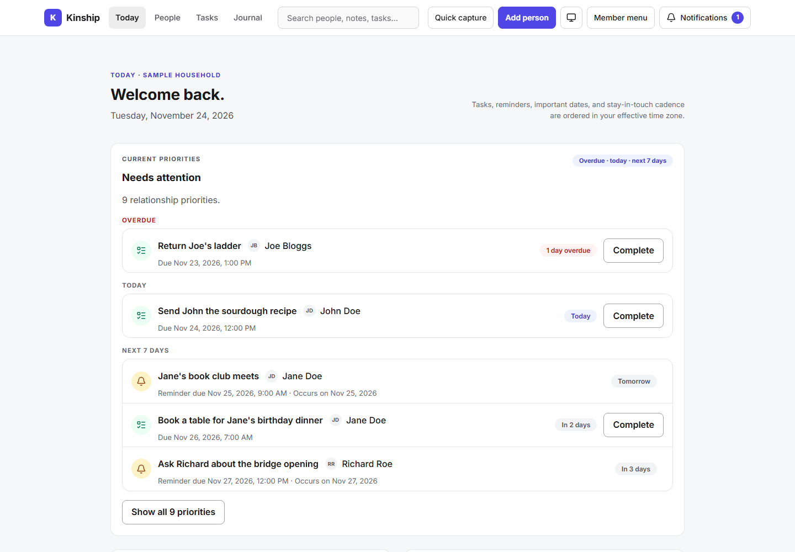
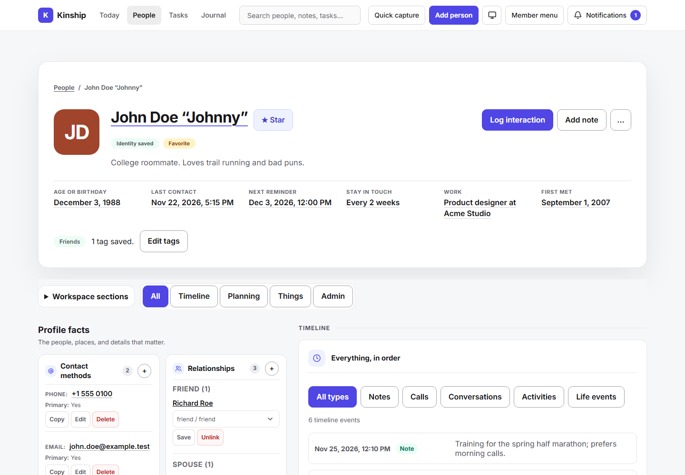
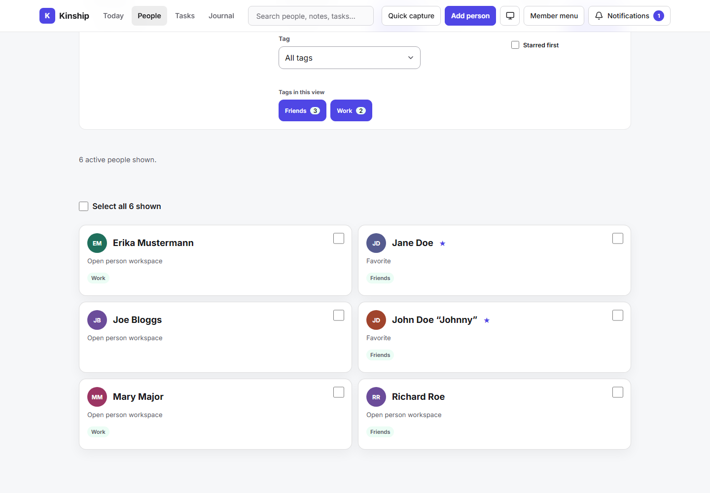
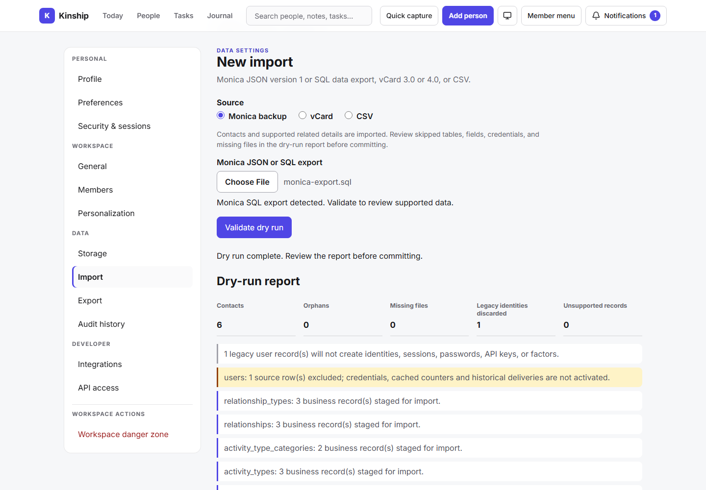
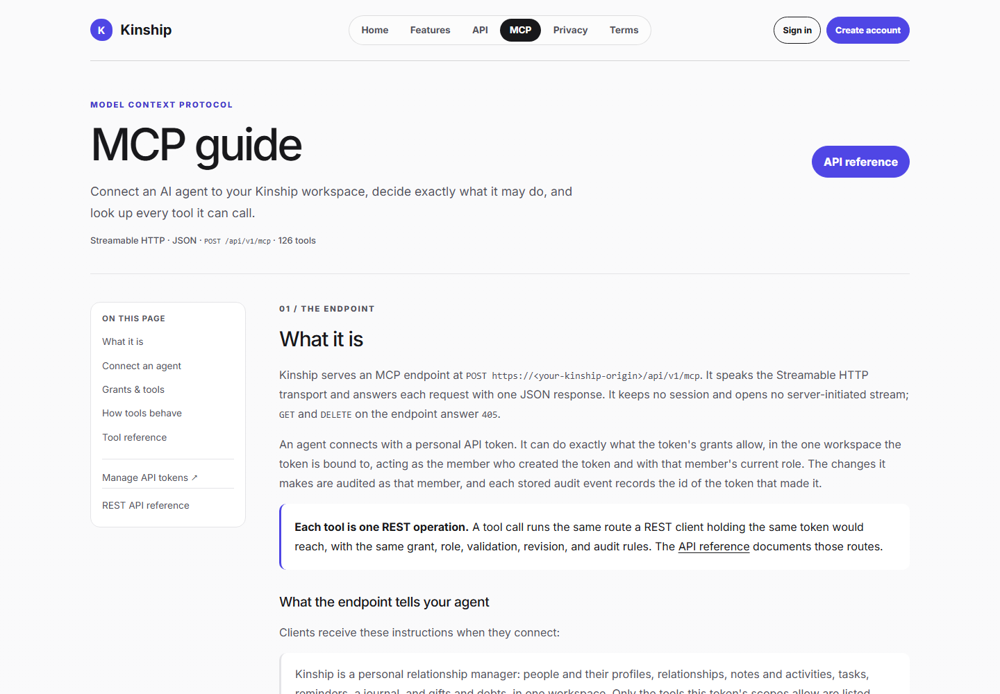

# Kinship

**A [Monica](https://github.com/monicahq/monica)-compatible, modern relationship
management system.** Kinship is a self-hosted personal CRM that keeps everything
you know about the people in your life in one place: who they are, how you know
them, what you last talked about, and what you promised to do next.

It keeps the breadth Monica users rely on, runs on a current production stack,
adds an MCP endpoint so an AI agent can work in your workspace, and imports your
existing Monica data with a full, reviewable report.



## Highlights

- **Monica-compatible.** Contacts, relationships, notes, activities, calls,
  reminders, tags, gifts, debts, journal entries, and important dates all have a
  home, so a Monica workspace moves over without losing its shape.
- **Fully supported Monica import.** Upload a Monica SQL data export or JSON
  export, review a dry-run report of everything that will and will not be
  imported, then commit in one transaction. vCard and CSV are supported too.
- **Built for AI agents.** A Model Context Protocol endpoint exposes 126 tools
  over the same scoped personal tokens the REST API uses, so an MCP client can
  look people up, log interactions, and manage tasks and reminders for you.
- **Modern stack.** Deno, Hono, PostgreSQL with row-level security, Astro with
  React islands, and shadcn/ui, shipped as a Docker Compose stack.
- **Yours to run.** Self-hosted, multi-workspace, with roles, audit history, and
  portable exports.

## Screenshots

The screenshots use invented sample data.

### One workspace per person

Every person has one page that brings together contact details, relationships,
important dates, work, food preferences, and a timeline of notes, calls,
activities, and life events, with tasks, reminders, gifts, debts, documents, and
photos alongside.



### People directory

Search by name or nickname, filter by tag, star favorites, and act on several
people at once.



### Monica import

The importer reads the export as data and never executes it. A dry run shows
what was found, what is unsupported, and which legacy credentials are discarded
before anything is written.



### MCP for AI agents

Create a scoped API token in settings, point an MCP client at
`POST /api/v1/mcp`, and the agent can do exactly what that token allows. Every
change is audited as the member who created the token.



## Features

**People**

- One person workspace with deep-linkable sections instead of a tree of
  subpages.
- Contact methods, addresses, work history, pets, food preferences, and how you
  met.
- Important dates with partial precision: a birthday without a year, or an
  approximate age.
- Directional relationships between people, with customizable relationship
  types.
- Avatars, tags, favorites, archiving, duplicate review, and merging.

**Staying in touch**

- A Today page that orders overdue, due-today, and upcoming work, and shows who
  you are due to reconnect with.
- Tasks, recurring reminders with email delivery, and stay-in-touch cadences.
- Notes, calls, conversations, and shared activities on a per-person timeline.
- A personal journal and life events.
- Gifts and debts, including recurring debts and settlements.
- Documents and photos stored in S3-compatible object storage.
- Workspace-wide search and a command palette.

**Data and integrations**

- Import from Monica (SQL or JSON export), vCard 3.0/4.0, and CSV.
- Export a whole workspace or a single person, plus contacts as CSV or vCard.
- A REST API with scoped personal tokens and a published OpenAPI reference.
- An MCP endpoint for AI agents over the same tokens and permissions.
- DAV synchronization and a subscribable calendar feed of dates and reminders.

**Workspaces and security**

- Multiple workspaces, invitations, and member roles.
- Password sign-in with multi-factor challenges and session management.
- Workspace isolation enforced by PostgreSQL row-level security, not only by
  application code.
- Audit history for changes, including the ones an API token or agent makes.

## Importing from Monica

Go to **Settings → Import → New import** and choose a Monica SQL data export or
a Monica JSON export.

1. **Validate.** The dry run parses the file and reports contacts, staged
   records per source table, unsupported rows and fields, missing files, and
   discarded credentials.
2. **Choose.** Pick how unmatched contact-method types, currencies, and genders
   map onto your workspace, and set the time zone used for imported reminders.
3. **Commit.** The import runs in one workspace-scoped transaction. A failure
   rolls everything back.

Imports are repeatable: running the same export again reuses what was already
imported and does not overwrite later edits. Legacy passwords, API keys, and
two-factor secrets are never activated.

[docs/product/monica-import-compatibility.md](docs/product/monica-import-compatibility.md)
lists exactly what is imported, the limits, and the exclusions.

## Technology

| Layer          | Choice                                                         |
| -------------- | -------------------------------------------------------------- |
| Backend        | Deno, TypeScript, Hono, Zod                                    |
| Database       | PostgreSQL 18 with forced row-level security, Kysely           |
| Frontend       | Astro (static-first), React islands, shadcn/ui on Base UI      |
| Styling        | Tailwind CSS                                                   |
| AI integration | Model Context Protocol endpoint (`@modelcontextprotocol`)      |
| Storage        | S3-compatible object storage (RustFS locally)                  |
| Delivery       | Docker Compose: nginx gateway, web renderer, API, worker       |
| Testing        | Deno tests, Vitest, Playwright end-to-end, PostgreSQL contract |

The backend is a modular monolith. The API and the background worker are built
from the same codebase and run as separate processes. Each module owns its
tables and exposes a public application interface; modules do not reach into
each other's storage. The gateway is the only public entry point: it serves the
prerendered pages and forwards `/api/v1/*` to the private API.

## Run locally

Install the pinned dependencies once with `deno task deps:deno` and
`deno task deps:node`, ensure Docker is running, then start PostgreSQL, the
baseline migration, Mailpit, object storage, the API, and Astro from the
repository root:

```sh
deno task dev
```

The command waits for PostgreSQL, migration, Mailpit, pinned RustFS object
storage, and API readiness before it starts Astro, and removes its
containers/network on exit while retaining the local PostgreSQL and RustFS
volumes. Open <http://127.0.0.1:4321>. Astro proxies `/api/v1/*` to the API at
<http://127.0.0.1:8000>.

## Configuration

Copy `.env.example` to `.env` and set `POSTGRES_PASSWORD` before starting
Compose. Configure local listeners with `POSTGRES_PORT`, `API_PORT`, `WEB_PORT`,
`SMTP_PORT`, `MAILPIT_PORT`, `OBJECT_STORAGE_PORT`, and
`OBJECT_STORAGE_CONSOLE_PORT`. `PUBLIC_WEB_ORIGIN`, `POSTGRES_DB`,
`POSTGRES_USER`, `APP_ENV`, `AUTH_MFA_ENCRYPTION_KEYSET`,
`AUTH_THROTTLE_SUBJECT_KEYSET`, `AUTH_MINIMUM_RESPONSE_MS`, `SMTP_HOST`, and
`SMTP_FROM` use the names shown in `.env.example`. There is no supported root
`PORT` or `API_ORIGIN` setting.

An unset `APP_ENV` is production. Production requires:

- `AUTH_MFA_ENCRYPTION_KEYSET`: bounded JSON containing `activeKeyId` and a
  `keys` object of key IDs to 32 random bytes encoded as unpadded base64url. New
  MFA material uses the active key while retained keys decrypt older material.
  Local development uses an explicitly non-production fallback when the variable
  is blank, and production refuses any keyset holding a key published in this
  repository.
- `AUTH_THROTTLE_SUBJECT_KEYSET`: keys for the pseudonymous authentication
  subjects used by durable pre-admission throttling. Its bounded JSON contains
  an integer `activeVersion` and a `keys` object with one to eight canonical
  version labels (`v1` or newer), each mapped to 32 random bytes encoded as
  unpadded base64url. Retain older versions while rotating, and never commit or
  log the keyset.
- `AUTH_SIGN_IN_DEVICE_KEYSET`: the same shape with keys of its own, to sign the
  sign-in device cookie that keeps a browser which signed in before exempt from
  the per-account sign-in ceiling.

`AUTH_MINIMUM_RESPONSE_MS` sets the sign-in and MFA response-duration floor. It
defaults to `250` and accepts only integer milliseconds in the inclusive range
`100` through `2000`.

Plain SMTP is deliberately restricted to the local Mailpit/loopback capture
adapter in explicit development or test environments; production startup rejects
that adapter until a certificate-validated TLS transport is configured. See
[docs/architecture/configuration-and-secrets.md](docs/architecture/configuration-and-secrets.md)
for the full contract.

## Development

Root `build`, `check`, `test`, `test:coverage`, and `test:e2e` tasks provide the
corresponding application gates.

- `deno task test:e2e` provisions a unique, disposable production-built Compose
  stack and runs all configured browsers through its sole public entry point, a
  TLS gateway on a Docker-assigned loopback port. The Astro renderer, API, and
  PostgreSQL services remain private; Mailpit's Docker-assigned loopback
  listener is exposed only as test control for captured mail. The gate always
  removes the exact test project and volumes.
- `deno task test:integration`, root `test`, and root `test:coverage` provision
  a clean disposable PostgreSQL project themselves; they do not consume an
  ambient `DATABASE_URL`.
- `deno task test:unit`, `test:integration`, `test:contract`, and
  `test:coverage` each accept `--module=<id>` to run one module's suite from
  `tools/tasks/manifest.ts`, which is the single source of truth for test
  composition, coverage includes, and permission sets. Root `test` always runs
  every aggregated module.
- The PostgreSQL schema tasks remain available and independent.

Optional local Git hooks live in `lefthook.yml`: install them once per clone
with `pnpm exec lefthook install` to get the staged-file formatter and lint
checks on commit and `test:unit` plus `test:contract` on push. They are never
installed automatically, because one `.git` directory is shared by every
worktree of this repository.

## Documentation

- [docs/architecture/README.md](docs/architecture/README.md): technology
  baseline, module boundaries, and architecture decisions.
- [docs/product/README.md](docs/product/README.md): pages, user flows, and the
  person workspace contract.
- [personal-crm-schema/v16/README.md](personal-crm-schema/v16/README.md): the
  canonical PostgreSQL schema.
- [docs/operations/private-production.md](docs/operations/private-production.md):
  running a private production deployment.

## License

Kinship is released under the [MIT License](LICENSE).
