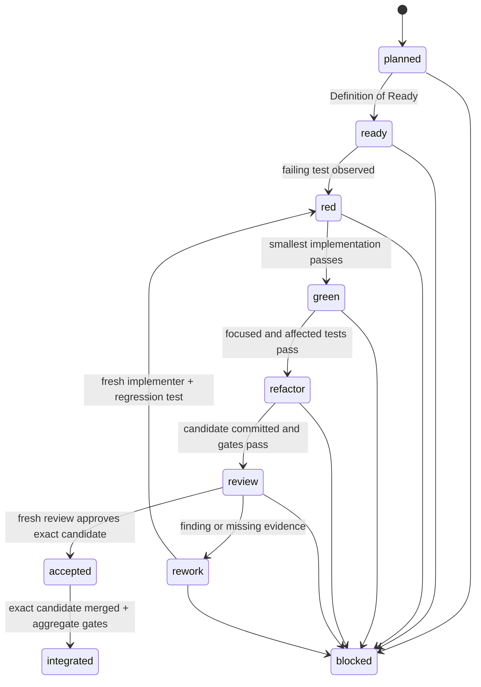
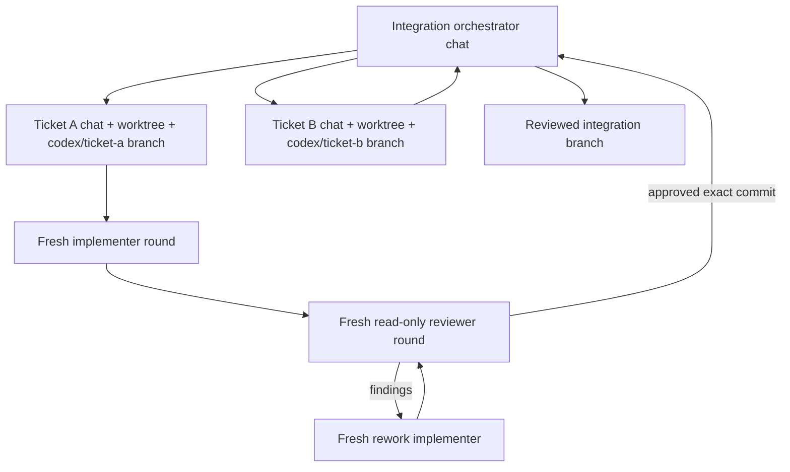

# Autonomous TDD Delivery

Status: Accepted repository workflow, 2026-08-11

This document defines how Codex turns an accepted roadmap item into reviewed,
integrated code without sharing implementation context with its reviewer. It is
subordinate to accepted architecture, schema, authorization, product, and
quality contracts. It cannot resolve an open product or architecture decision by
itself.

## Non-negotiable invariants

1. Every new or changed production behavior begins with an automated test or
   deterministic executable check that is observed RED before production code
   changes.
2. RED must fail for the intended missing or incorrect behavior. Compilation,
   fixture, environment, permission, timeout, or unrelated failures do not
   count.
3. GREEN is the smallest compliant change that satisfies the RED proof.
4. REFACTOR may improve structure only while behavior remains green.
5. The implementer never approves its own candidate.
6. Every implementation, rework, and review round starts in a fresh agent
   thread. Versioned files, not chat history, are the handoff.
7. Review covers correctness, security, architecture, performance,
   maintainability, and test integrity against one exact candidate revision.
8. Every actionable finding returns to RED, GREEN, REFACTOR, and a new review.
9. The orchestrator accepts and integrates only the exact revision approved by a
   fresh reviewer and independently verified by the orchestrator.
10. Parallel write-enabled agents never share a worktree.

Coverage remains mandatory, but coverage obtained from tests written after the
implementation is not RED evidence. The first RED proof in a round is frozen as
an exact test-only Git revision before GREEN. The ticket retains that revision,
the command, non-zero exit, intended assertion, focused output, test-only change
list, and a lowercase SHA-256 digest of every changed test/check file's exact
bytes.

## Roles and authority

### Orchestrator

The orchestrator owns the delivery queue and is the only role allowed to:

- select a ready ticket and decide whether tickets are independent;
- create the branch, worktree, ticket packet, state transitions, and dispatch
  packets;
- choose the required gate matrix from the actual change and accepted contracts;
- persist reviewer output, resolve duplicate findings, and decide whether an
  observation is actionable;
- accept a candidate, merge it into the integration branch, and declare a ticket
  integrated.

The orchestrator does not implement feature code or silently fix a finding. When
it discovers a defect, it writes a finding and dispatches a fresh implementer.
It independently reruns gates instead of trusting agent prose.

### Feature implementer

The feature implementer owns one ticket round in one worktree. It may change
only declared scope. It produces RED, GREEN, and REFACTOR evidence and a green
candidate tree for the trusted controller to commit. It cannot change ticket
authority, waive a finding, mark a ticket accepted, commit, merge, or review
itself.

For review rework, the implementer first creates a regression test or static
check for each dispatched finding and observes the intended failure. A prose
claim that a finding is fixed is insufficient.

### Reviewer

The reviewer is read-only and starts with a fresh context. It receives the
ticket, accepted contract references, base revision, exact candidate revision,
base-to-candidate diff, and phase evidence. It receives no implementation chat
or hidden orchestrator diagnosis.

The reviewer returns findings first, an evidence-backed attestation for every
review lens, commands actually run, the exact revision reviewed, and either
APPROVED or CHANGES_REQUESTED. It does not edit or commit.

A live parent permission override can be reapplied to spawned agents, so the
read-only custom-agent setting is defense in depth rather than the only guard.
The orchestrator records the candidate revision and clean status before review
and verifies both are unchanged afterward. For high-risk changes, run the
reviewer as a separate top-level read-only Codex invocation.

## Ticket files

Keep one tracked directory per ticket:

```text
docs/planning/tickets/<ticket-id>/
  ticket.md
  ticket.json
  state.json
  events.jsonl
  dispatch/
    round-02.md
  results/
    round-01.json
  evidence/
    round-01-red.log
    round-01-green.log
    round-01-refactor.log
  reviews/
    round-01.json
  acceptance.md
```

The skill templates under .agents/skills/run-tdd-ticket-loop/assets/ initialize
these files. ticket.json is the strict machine-readable packet and ticket.md is
its human-readable explanation; they must agree. The orchestrator owns both
ticket files, state.json, events.jsonl, dispatch files, persisted reviews, and
acceptance.md. An implementer writes ticket-scoped code and evidence logs, then
returns a structured result. The trusted controller creates the green candidate
commit. The orchestrator persists result JSON in a later metadata-only commit
after the candidate ID is known. A reviewer returns its structured result to the
orchestrator for the same kind of metadata-only persistence.

Bind packets and evidence to full Git commit IDs, never only a branch name or a
floating HEAD. Logs must be concise and redact credentials, personal data,
cookies, tokens, connection strings, and rendered secret configuration.

### Ticket packet

ticket.md and ticket.json must contain:

- one observable outcome;
- base revision and dependency ticket IDs;
- in-scope and out-of-scope behavior;
- accepted architecture, product, schema, authorization, and decision
  references;
- stable, independently testable acceptance criteria;
- the focused RED proof expected for each criterion;
- applicable existing repository gates;
- security, tenancy, data, compatibility, concurrency, and performance risks;
- explicitly unresolved decisions. A ticket with a blocking unresolved decision
  is not ready.

The JSON packet additionally declares a schema version, ticket revision, maximum
rounds, allowed write paths, stable acceptance-criterion IDs, and required root
task names. Required tasks must exist in deno.json and have truthful
implementations; arbitrary shell strings are not accepted as ticket-wide gates.

### State record

state.json uses schemaVersion 1 and one of these states:

- planned
- ready
- red
- green
- refactor
- review
- rework
- accepted
- integrated
- blocked
- cancelled

It records the base revision, ordered phase events, implementation rounds,
reviews, orchestrator checks, open findings, and accepted candidate revision.
Its `dependencyRevisions` object maps every dependency ticket ID to the exact
integrated Git revision verified before the ticket became ready. The repository
validator rejects unknown properties and invalid transitions. events.jsonl is
the append-only human-auditable transition ledger; state.json is the current
machine-readable summary. The ordered transition views use one contract:
state.events exactly matches events.jsonl. Each entry includes the transition's
evidence reference and exact revision. Append a new line and matching state
event for every transition; never rewrite prior ledger lines or failed round
evidence.

Each implementation round records:

- round number and fresh implementer run ID;
- input dispatch path and base revision. Results form contiguous one-based
  history within `maxRounds`: round one uses the ticket base and every later
  round uses the immediately preceding candidate revision;
- exact test-only RED revision; RED command, exit code, intended assertion,
  concise redacted output, log path, changed test/check paths and their SHA-256
  file digests, and an empty production-file change list;
- GREEN command, zero exit code, log path, and changed production files;
- REFACTOR summary, command, zero exit code, and broader gates;
- resulting clean candidate commit ID, filled only after the trusted controller
  creates that commit.

A Git commit cannot contain its own commit ID. Do not put a guessed or floating
HEAD value into the candidate commit. Use this sequence:

1. commit the first failing test/check and RED log as the test-only RED
   revision, then record its full Git ID and SHA-256 file digests in the GREEN
   dispatch;
2. resume the same round, verify the frozen RED revision and file digests, and
   commit code, tests, and redacted phase logs as the candidate;
3. record that candidate ID in result/state files and commit only ticket
   metadata;
4. review the recorded candidate ID;
5. persist the review in another ticket-metadata-only commit.

Before acceptance and integration, verify that every path changed after the
candidate commit is inside that ticket's docs/planning/tickets/<ticket-id>/
directory. Any other change creates a new candidate and invalidates the review.
Run this validation from the canonical project Git root against that exact
ticket path. The ticket tree must contain no symlink, junction, or other link
component; all ticket metadata and referenced evidence must be clean and
committed at HEAD, and HEAD must descend from the reviewed candidate. Untracked,
dirty, external-repository, non-descendant, or post-candidate production
evidence is invalid.

Each review records:

- round number and a fresh reviewer run ID different from the implementer;
- exact base and candidate commit IDs;
- commands and evidence inspected as unique `{ command, exitCode }` records;
- one evidence-backed record for every required lens;
- findings and resolution state;
- APPROVED or CHANGES_REQUESTED.

## State machine



Mechanical transition guards:

| Transition             | Required evidence                                                                                                                                                 |
| ---------------------- | ----------------------------------------------------------------------------------------------------------------------------------------------------------------- |
| planned to ready       | Definition of Ready complete, dependencies integrated, accepted decisions resolved, clean base recorded, runnable RED command available                           |
| ready or rework to red | Test/check-only change, intended non-zero failure, relevant pre-existing baseline still green                                                                     |
| red to green           | Frozen RED test now passes; no weakening, deletion, skip, exclusion, or expectation reversal                                                                      |
| green to refactor      | Focused and affected suites pass; implementation is minimal and in scope                                                                                          |
| refactor to review     | Exact clean candidate commit plus later metadata record; applicable format, lint, type, architecture, coverage, integration, schema, contract, and E2E gates pass |
| review to rework       | Any actionable finding, failed gate, missing lens/evidence, stale revision, or changed candidate                                                                  |
| review to accepted     | Fresh reviewer covered all lenses for exact candidate; no open actionable finding; orchestrator independently verified gates                                      |
| accepted to integrated | Exact reviewed commit merged; integration tree clean; aggregate gates pass                                                                                        |

The event `round`, `revision`, `actorRunId`, and `evidenceRef` are derived from
the full `from`/`to` transition, not trusted independently. `planned` to `ready`
uses the ticket at round zero; `ready` to `red` starts round one; `rework` to
`red` starts the next round; other implementation transitions keep the active
round. RED/GREEN/REFACTOR transitions use their phase logs, `refactor` to
`review` uses the round result, `review` to `rework` uses the round review, and
acceptance/integration transitions use `acceptance.md`.

Changing production code, tests, generated output, contracts, or a relevant
configuration after review invalidates the review. Conflict resolution is a
change and therefore requires new evidence and review.

## RED, GREEN, and REFACTOR rules

### RED

- Add the narrowest test at the lowest layer that can discriminate the required
  behavior. Add higher-layer contract or E2E proof when the observable contract
  requires it.
- A bug fix starts with a failing regression test.
- A UI flow starts with the stable flow ID in its Playwright test before the UI
  behavior is implemented; keep deliveryStatus planned until the complete flow
  passes.
- A schema or migration change starts with a schema/behavior test against real
  PostgreSQL. It cannot mutate only one file in the synchronized schema bundle.
- A documentation, catalog, configuration, generator, architecture-enforcement,
  or infrastructure change starts with a failing validator, contract test,
  schema test, or bounded executable probe.
- If no harness exists, bootstrap and self-test the smallest truthful harness
  first. Do not add a no-op task merely to claim RED.

### GREEN

- Change the least production code necessary.
- Preserve module ownership, public facade use, workspace isolation, read-only
  read models, schema authority, and static-first frontend boundaries.
- Do not delete, weaken, skip, over-mock, or exclude the RED assertion.
- Do not broaden runtime permissions, dependency direction, product scope, or
  architecture to make a test pass.

### REFACTOR

- Remove duplication and improve naming, boundaries, and maintainability only
  after GREEN.
- Run the focused test after each structural step and the affected broader suite
  before producing a candidate.
- New behavior discovered during refactoring begins a new RED cycle.
- A behavior-preserving standalone refactor begins from adequate
  characterization tests; if coverage is missing, add it before restructuring.

## Review contract

The review JSON contains exactly these lenses:

1. bug_correctness
2. security_privacy
3. architecture_contracts
4. performance_reliability
5. style_maintainability
6. tests_tdd

Each lens has verdict pass, fail, or not_applicable and non-empty evidence. A
not_applicable result additionally carries `notApplicableAgreement` with a
non-empty `orchestratorRunId`, `scopeOrContractRef`, and `rationale`. The
citation must exactly match declared ticket scope or a contract reference; N/A
is not a shortcut around analysis.

An actionable finding contains:

- stable ID and lens;
- severity P0, P1, P2, or P3;
- exact path plus line, symbol, route, query, or configuration key;
- expected and observed behavior, reproduction, and concrete impact;
- affected acceptance criterion and contract reference;
- required remediation and the regression test/static check that proves it;
- status open, resolved, or waived.

All actionable findings block acceptance regardless of severity. Use a separate
notes array for genuinely optional observations. A waived finding carries a
`waiver` object with non-empty `authority`, `rationale`, `owner`, and a valid
future `expiresAt`. Only P2/P3 findings under bug/correctness,
performance/reliability, or style/maintainability may be waived. P0/P1 findings
and every security/privacy, architecture/contracts, or tests/TDD finding are
non-waivable.

Reviewer lens guidance:

- Bug/correctness: edge cases, partial failure, error mapping, concurrency,
  ordering, time zones, idempotency, stale state, and regression behavior.
- Security/privacy: authentication, authorization, workspace isolation,
  injection, CSRF/origin, secret and personal-data exposure, file handling,
  unsafe defaults, and dependency risk.
- Architecture/contracts: module manifest, table ownership, public facades,
  read-model immutability, schema source of truth, API/product/catalog drift,
  rendering boundary, and accepted ADRs.
- Performance/reliability: N+1 access, unbounded data, indexes, transaction and
  lock duration, memory, retries, idempotency, backpressure, failure recovery,
  resource cleanup, and relevant budgets.
- Style/maintainability: unnecessary complexity, unclear names, duplication,
  leaky abstractions, unsafe assertions, dead code, and repository conventions.
- Tests/TDD: valid RED discrimination, branch/function/line coverage, missing
  negative cases, excessive mocking, flake risk, permissions, E2E flow IDs,
  browser coverage, and test weakening.

## Orchestrator acceptance guard

The orchestrator may mark accepted only when all of these are true:

- ticket state and transition evidence validate;
- exact candidate commit matches the approved review, and every later change is
  confined to that ticket's metadata directory;
- every acceptance criterion maps to passing evidence from that candidate;
- RED evidence proves production files were untouched in RED;
- every required review lens has evidence and there are no open findings;
- the approved review records at least one unique command and every recorded
  exit code is zero;
- the orchestrator independently reran the focused test and every applicable
  currently implemented gate;
- production TypeScript retains 100% line, branch, and function coverage;
- every delivered user flow has a real Playwright reference and required browser
  and accessibility proof;
- architecture, authorization, workspace isolation, schema, generated contract,
  catalog, dependency, permission, security, and secret-redaction checks pass as
  applicable;
- synchronized schema changes pass the PostgreSQL 18/17 matrix;
- no proposed plan or unresolved decision was silently treated as accepted.

Ticket acceptance is not milestone, deployment, backup/restore, or production
readiness acceptance. Those have separate aggregate gates.

## Worktrees, branches, and threads

Use one long-lived integration chat and branch plus one Codex chat/worktree per
independent ticket:



Branch names use codex/<ticket-id-lowercase>-<slug>. Record the integration base
commit in the ticket before work starts. A ticket worktree has one write owner;
reviewers are read-only. Independent tickets may run concurrently only when
their dependency, module/table ownership, generated-file, schema, and shared
contract write sets do not overlap.

Each ticket chat must be a top-level Codex task rooted in that ticket's
worktree. Spawn its orchestrator/implementer/reviewer roles from there so they
inherit the correct checkout. The native subagent interface does not provide an
independent worktree selector; do not spawn a writer from the integration
checkout and point it at a sibling worktree. The integration controller creates
or opens the top-level worktree tasks, then consumes only reviewed commit IDs
and ticket evidence from them.

After one ticket merges, update every stale candidate from the integration
branch. A conflict is dispatched to a fresh implementer, not resolved ad hoc by
the orchestrator. The updated commit goes through review again.

Codex-managed worktrees may start detached. Create a ticket branch in that
worktree before committing. A branch can be checked out in only one worktree.
Use Handoff when moving a Codex chat between Local and Worktree rather than
trying to check out the same branch twice.

Workspace-write agents cannot mutate protected Git metadata in normal Codex
sandboxes. The trusted primary controller performs branch, worktree, commit,
merge, and cleanup operations using the permission mode granted for the parent
run; it never broadens a child sandbox to bypass this boundary. The orchestrator
supplies and verifies the exact requested Git action, while implementers and
reviewers operate on the assigned checkout.

<!-- deno-fmt-ignore -->
For ordinary ticket work, `.git`, `.codex`, and `.agents` are protected control paths.
Spawned workspace-write implementers must route any required change to those paths to a trusted top-level maintenance context.
This guidance documents authority routing; it does not override Codex sandbox
enforcement.

## Command truth

Run only tasks that exist and have real implementations. The current executable
root tasks are:

- deno task fmt
- deno task fmt:check
- deno task lint
- deno task check
- deno task ticket:validate <ticket-directory>
- deno task test:workflow
- deno task test:workflow:coverage
- deno task test:schema
- deno task test:schema:compat
- deno task test:schema:matrix

Their scope is still narrow: lint covers tools, check covers the schema and
workflow tools, the workflow tasks validate autonomous ticket records with 100%
line/branch/function coverage, and the schema tasks cover the canonical database
harness. Planned app, UI, contract, E2E, aggregate coverage, CI, hook, and
Compose tasks become gates only when a real harness is added through its own
RED/GREEN ticket. Never report a planned task as passed and never add a no-op
placeholder.

## Codex capability basis and local compatibility

This design follows the official Codex documentation for
[project instructions](https://learn.chatgpt.com/docs/agent-configuration/agents-md),
[custom subagents](https://learn.chatgpt.com/docs/agent-configuration/subagents),
[repo-local skills](https://learn.chatgpt.com/docs/build-skills),
[Git worktrees](https://learn.chatgpt.com/docs/environments/git-worktrees), and
[long-running goals](https://learn.chatgpt.com/docs/long-running-work).

Local verification on 2026-08-11 used Codex CLI 0.146.0. The checked-in project
configuration passed strict read-only parsing, and the desktop subagent surface
is used for the role-loop pilot. An ephemeral CLI multi-agent smoke on 0.146.0
failed internally while attaching the child thread, so do not use ephemeral
codex exec as the unattended launcher on that version. Upgrade the CLI and
repeat an actual spawn-event smoke before adopting non-interactive CLI
orchestration. Persistent desktop tasks/worktrees remain the supported path for
the workflow documented here.

## Autonomous loop and escalation

The orchestrator continues selecting, dispatching, reviewing, integrating, and
retesting ready tickets until the requested goal is met. It reports status from
ticket files and Git revisions, not conversational memory.

After three rounds fail on the same blocker, start one fresh diagnostic review,
split the ticket if that preserves accepted behavior, and attempt the smaller
ready work. Pause only when no safe in-scope path remains because of:

- an unresolved product/architecture decision with materially different
  outcomes;
- missing external credentials, approval, authority, or service state;
- a destructive action outside the authorized scope;
- a repeated blocker that survived the independent diagnostic path.

Record the exact blocker, attempts, evidence, and smallest decision needed from
the user. Difficulty, elapsed time, or a failed first approach is not a blocker.

## Starting an MVP run in Codex

Start from a clean integration branch and use Goal mode with a bounded outcome,
for example:

```text
/goal Use $run-tdd-ticket-loop to deliver the next dependency-ready tickets from
the accepted MVP plan. Use one Codex worktree/chat per independent ticket,
strict RED-GREEN-REFACTOR evidence, fresh implementer and reviewer contexts,
review-driven rework, and aggregate integration tests. Continue until the
selected milestone is accepted or a documented escalation condition is real.
```

For the safest first production run, select one vertical slice and cap parallel
write tickets to the number of clearly disjoint worktrees. Increase concurrency
only after integration and E2E runtimes are measured and the ticket validator
has proven reliable.
