# MVP To Feature-Complete Roadmap

## Delivery Assumption

### Execution reset (2026-08-14)

Task order comes from [`active-delivery.md`](active-delivery.md). Application
delivery starts now. The detailed Foundation packages below are reference
backlog, not a blocking wave, and are pulled into a vertical ticket only when
that ticket consumes them. Do not complete all spikes, enforcement, CI,
telemetry, gateway, or design-system work before building the runnable app.

The existing P0/P1/P2 priorities and the PRODUCT-001 release subset are
authoritative. The catalog-derived Proposed MVP and Core feature complete cuts
currently coincide after Slice 7. An earlier release is Core alpha after Slice
4, but it omits P0 files, import, and export. Production readiness remains an
independent release decision.

The roadmap uses vertical slices. Each work package includes the server use
case, persistence, API contract, generated client, user interface, telemetry,
and required automated proofs. Infrastructure-only groundwork is limited to
Slice 0 and must culminate in a working protected path.

Section headings group the scope; they are not execution order. For every
package, write and observe the relevant Required proof tests/checks failing
before the corresponding server, data, UI, container, configuration, or tooling
behavior is implemented, then follow RED -> GREEN -> REFACTOR and fresh review.

## Dependency Shape

```mermaid
flowchart LR
  C["Contract and decision closure"] --> F["Executable foundation"]
  F --> I["Identity and workspaces"]
  I --> P["People core"]
  P --> R["Profile facts and relationships"]
  R --> H["Interactions and history"]
  H --> T["Planning, worker, and Today"]
  T --> X["Files, gifts, and debts"]
  X --> J["Journal and governance"]
  J --> D["Import, export, and destructive lifecycle"]
  D --> MVP["Proposed MVP and core feature complete"]
  MVP --> O["Optional platform modules"]
  C --> A["AI product and privacy decision"]
  A --> AI["Approved AI vertical slices"]
  F --> Q["Parallel production-readiness work"]
  Q --> PR["Core production-release proof"]
  MVP --> PR
  O -. "when enabled" .-> OPR["Optional-module release proof"]
  AI -. "when enabled" .-> AIPR["AI release proof"]
```

Audit writes, import adapters, workspace-reset participation, accessibility, and
observability grow with every slice rather than appearing as end-stage projects.

Cross-module work remains use-case-specific. DG-06A must approve the first
coordinators before Slice 1 mutations: the recommended starting point is a
workspaces-owned onboarding/invitation application service calling the allowed
identity public facade, plus governance event handlers wired at the composition
root and proven to share the required transaction boundary. DG-06B must then add
or reject planning consumption of `interactions.interaction-recorded` for
`stay_in_touch_cadences.last_contacted_at` before Slices 3/4; an interactions
adapter must never write planning tables. DG-06C covers files with people/gifts,
and DG-06D covers the full destructive-lifecycle coordinator. Each gate closes
independently, and every edge must exist in `module-boundaries.yaml` before code
relies on it.

DG-05 and DG-06B are accepted for PLANNING-002 by ADR 0005. Durable reminder
delivery uses canonical schema v6 and the bounded idempotent `in_app` provider;
planning consumes `interactions.interaction-recorded` through public facades
with monotonic calendar cadence updates. Generic worker supervision and other
providers remain outside this closure.

All Monica/source-format parsers, mappings, and reconciliation fixtures belong
to `import-export`. Each target module exposes an explicit public,
authorization-preserving import command; source-format types never enter its
domain. Incremental import work below means extending that outer adapter and its
public-facade tests alongside each slice, never reversing the dependency. The
currently allowlisted integrations facade remains disableable. Optional or
runtime modules not on the allowlist register extensions from their outer side
or require an approved manifest change; `import-export` may not reach into
billing, API-access, or operations internals.

Slice 7 core import/export must run with the integrations module disabled. Its
allowed integrations dependency is satisfied through a public disabled/null
facade and does not make Slice 8 a prerequisite. DG-09 decides whether optional
source records are rejected, reported and skipped, or preserved inertly for
later enablement.

## Decision Gates

Decision gates are resolved just in time before the affected behavior ships.
They do not collectively block APP-001 or unrelated vertical work. A ticket may
make the smallest explicit decision it needs without completing every future
gate.

| ID     | Decision                                                   | Blocks                                                                                          | Recommended direction and required evidence                                                                                                                                                                                                                                                                                                                                                                                                                                          |
| ------ | ---------------------------------------------------------- | ----------------------------------------------------------------------------------------------- | ------------------------------------------------------------------------------------------------------------------------------------------------------------------------------------------------------------------------------------------------------------------------------------------------------------------------------------------------------------------------------------------------------------------------------------------------------------------------------------ |
| DG-01  | Production rendering for the five Astro `on-demand` routes | Foundation                                                                                      | Promote `web` to a private production/test Astro runtime behind `gateway`, while keeping static assets at the gateway and `astro dev` in the dev override. Update ADR 0001, the technology baseline, and the Compose/configuration/observability contracts. Prove all five routes through the production-like gateway.                                                                                                                                                               |
| DG-02  | Migration runner, metadata, and database-role boundary     | Foundation                                                                                      | Compare a repository-owned Deno/raw-SQL runner with a dedicated CLI. Require lock, checksums, plan/status/apply/verify, kill recovery, and real PostgreSQL tests. If metadata tables are needed, create a synchronized schema version first. Decide which roles/grants are deployment bootstrap versus schema-owned; Compose init scripts cannot become an unversioned database authority.                                                                                           |
| DG-03  | Better Auth adoption or rejection                          | Slice 1                                                                                         | Use only public schema customization or a maintainable public adapter. Test exact canonical tables, Deno/Hono operation, password/MFA/passkey/recovery/session/CSRF behavior, workspace isolation, and imported-credential policy. Update ADR 0002.                                                                                                                                                                                                                                  |
| DG-04  | Kysely/Postgres.js and OpenAPI implementation packages     | Foundation                                                                                      | Prove the exact pinned Kysely/Postgres.js dialect on Deno against PostgreSQL 17/18. Separately prove deterministic OpenAPI 3.1, RFC 9457 variants, uploads, partial dates, and generated-client drift. Do not substitute `pg` or OpenAPI 3.0 silently.                                                                                                                                                                                                                               |
| DG-05  | Durable background execution and recovery                  | Foundation feasibility; final design before Slices 4, 7, and 8                                  | Prove claim, lease, attempt, retry, cancellation, resume, process-death, provider-timeout, and duplicate-execution semantics for reminders, import/export, and DAV. If the canonical rows cannot represent the required guarantees, approve a synchronized schema version first. `scheduled_job_runs` is observability, never the queue.                                                                                                                                             |
| DG-06A | Onboarding, invitation, and atomic-audit coordination      | Foundation and before Slice 1 mutations                                                         | Define transaction ownership for first-user/workspace creation, invitations, and required governance audit effects through allowed public facades/event handlers. Prove rollback and postcondition behavior; do not introduce a generic horizontal service or private import.                                                                                                                                                                                                        |
| DG-06B | Interaction-to-planning coordination                       | Before Slices 3/4                                                                               | Approve or reject consumption of `interactions.interaction-recorded` for `stay_in_touch_cadences.last_contacted_at`. Prove idempotency, ordering, retry/rollback behavior, and the manifest edge; interactions code never writes planning tables.                                                                                                                                                                                                                                    |
| DG-06C | File-backed avatar and gift coordination                   | Before Slice 5                                                                                  | Define use-case-specific coordination through the people, files, and gifts public facades, including transaction/post-commit object compensation. Prove ownership of `person_avatars` and `gift_file_links` and all failure interleavings.                                                                                                                                                                                                                                           |
| DG-06D | Destructive lifecycle and object cleanup coordination      | Before Slice 7                                                                                  | Define reset/delete participation, ordering, atomic database boundaries, session effects, post-commit object cleanup/reconciliation, retries, and optional-module extensions. Prove every dependency/event edge without importing private adapters.                                                                                                                                                                                                                                  |
| DG-07  | Remaining product/catalog closure                          | Before affected slice                                                                           | PRODUCT-001 accepts the bounded release assignments and milestones; follow-up gates remain open for life-event coverage, operations/help surfaces, page-flow semantics, state inheritance, P2 availability, multi-workspace/security/avatar/romantic/saved-filter behavior, and external API parity. Regenerate catalog-derived counts and cuts after any later catalog change.                                                                                                      |
| DG-08  | AI assistance product, privacy, and architecture           | Before any AI code                                                                              | Choose user outcomes, permissions, provider/data-retention policy, human-confirmation rules, evaluation set, failure behavior, page/flow IDs, module/read-model access, and persistence needs. The safest first candidate is a user-requested draft or summary over explicitly selected person data, with no autonomous mutation or send.                                                                                                                                            |
| DG-09  | Monica import security and optional-module policy          | Slice 7                                                                                         | Preserve the accepted invariant that imports never activate legacy credentials. Decide which password/TOTP/WebAuthn material may be preserved only in inert form, reported/discarded, or must force reset/re-enrollment; reconcile the canonical mapping through a synchronized bundle if needed. Also define source profiles/versions/sizes/retention and disabled optional-module treatment.                                                                                       |
| DG-10  | Security, capacity, and production objectives              | Security checkpoint before Slice 1; MVP performance checkpoint; production-readiness checkpoint | MVP checkpoint accepted 2026-08-24: [`mvp-capacity-profile.json`](mvp-capacity-profile.json) fixes the private-use datasets, desktop/browser baseline, burst of three users, and functional budgets for current UI/API/query/worker/import/export boundaries. Before production promotion, separately choose deployment ingress/TLS, object storage, mail, telemetry, SLOs/error budgets, RTO/RPO, retention, backup/restore, and secret management. Keep providers behind adapters. |
| DG-11  | Audit record surviving workspace deletion                  | Slice 7                                                                                         | Resolved 2026-08-23: synchronized schema v7 stores the minimal durable lifecycle record and bounded pending object keys outside the workspace cascade. It is neither a general audit ledger nor a job framework; telemetry remains non-authoritative.                                                                                                                                                                                                                                |
| DG-12  | Gateway implementation and production-like test TLS        | Foundation                                                                                      | Select and pin the gateway implementation, routing/config generation, security-header and forwarding behavior, and a test-CA or explicitly accepted TLS alternative for secure-cookie/origin/CSRF E2E. Deployment-specific ingress/TLS providers remain DG-10.                                                                                                                                                                                                                       |
| DG-13  | CI provider and workflow trust policy                      | Provider-specific FND-12 configuration                                                          | Keep RED-proven root commands provider-neutral and add Lefthook only after they work locally. Then choose the CI provider, trigger/fork trust model, minimum token permissions, secret boundary, immutable reusable-step policy, artifact retention, and required-check mapping before committing provider workflow files.                                                                                                                                                           |

### Decision Control

The accountable roles below must be replaced by named people at implementation
kickoff. A gate without a named owner and accepted artifact remains open.

| Gate   | Owner                                                    | Status                                                             | Decision artifact                                                                                                 |
| ------ | -------------------------------------------------------- | ------------------------------------------------------------------ | ----------------------------------------------------------------------------------------------------------------- |
| DG-01  | Architecture owner                                       | Open                                                               | ADR 0001 plus synchronized technology/Compose/configuration/observability contracts                               |
| DG-02  | Database/platform owner                                  | Open                                                               | ADR 0003 result; synchronized schema bundle if metadata persists                                                  |
| DG-03  | Identity/security owner                                  | Open                                                               | ADR 0002 accept/reject result and compatibility evidence                                                          |
| DG-04  | Backend/API owner                                        | Open                                                               | Pinned compatibility report, manifests/lockfiles, and generation contract                                         |
| DG-05  | Worker/data-lifecycle owner                              | Accepted for reminder delivery; later workloads retain checkpoints | ADR 0005, schema v6, and PLANNING-002 failure matrix                                                              |
| DG-06A | Architecture, identity, workspace, and governance owners | Open                                                               | Onboarding/invitation/audit transaction record and any manifest/ADR amendment                                     |
| DG-06B | Architecture, interactions, and planning owners          | Accepted                                                           | ADR 0005 and `interactions.interaction-recorded` manifest edge                                                    |
| DG-06C | Architecture, people, files, and gifts owners            | Open                                                               | Avatar/gift file-ownership and compensation decision                                                              |
| DG-06D | Architecture, lifecycle, and affected module owners      | Open                                                               | Reset/delete participation, transaction, and cleanup decision                                                     |
| DG-07  | Product owner                                            | Partially closed by PRODUCT-001; follow-up gates open              | Accepted bounded release amendment; later product artifacts for each deferred gap                                 |
| DG-08  | Product, privacy, and security owners                    | Open                                                               | AI capability/privacy contract and architecture decision                                                          |
| DG-09  | Import/product/security owners                           | Open                                                               | Import support and credential policy; synchronized mapping/schema bundle if changed                               |
| DG-10  | Security, product/performance, and operations owners     | MVP checkpoint accepted 2026-08-24; production checkpoint open     | [`mvp-capacity-profile.json`](mvp-capacity-profile.json), then a production SLO/provider/retention/runbook record |
| DG-11  | Security/data-governance owner                           | Accepted 2026-08-23                                                | Synchronized `personal-crm-schema/v7` lifecycle record and cleanup contract                                       |
| DG-12  | Platform/security owner                                  | Open                                                               | Gateway decision, pinned image/config contract, and TLS test proof                                                |
| DG-13  | Platform/security owner                                  | Open                                                               | CI provider/trust decision, permissions map, immutable-step policy, and required-check map                        |

## Slice 0: Prove The Foundation

### Outcome

A protected request travels through the production-like gateway and rendering
path selected by DG-01, then the Deno/Hono API, application use case, real
PostgreSQL, generated OpenAPI client, and accessible UI. Architecture and
quality checks make illegal shortcuts fail before feature volume grows.

### Foundation Wave A: Close Contracts And Pin The Toolchain

#### FND-01: Contract repair

- Resolve DG-01 and correct all affected architecture/product documents.
- Preserve the PRODUCT-001 release assignments for `WORKSPACE-001` and
  `PEOPLE-003` while keeping catalogs synchronized when later decisions change
  them.
- Resolve the explicitly deferred life-event, operations-admin,
  security-settings, multi-workspace, page-state, help/what's-new, saved-filter,
  and external-API gaps before their affected behavior ships.
- Preserve the accepted `Core alpha`, `Proposed MVP`, `Core feature complete`,
  `Catalog complete`, `AI-enabled complete`, and `Production ready` meanings in
  the planning entry point.
- Keep every unresolved capability visibly open; do not let a missing flow look
  delivered because its table exists.
- After any later DG-07 catalog decision, regenerate priority/milestone counts
  and require every accepted flow to appear exactly once in the release and
  traceability matrices.

Exit proof: all planned work has an authoritative page/flow/module/permission
home, or a named decision gate and owner.

#### FND-02: Runtime and dependency pins

- Create the Deno workspace and member-specific configurations only for paths
  that contain real code.
- Create the pnpm workspace/source-resolution path for `apps/web`,
  `packages/contracts` generated consumers, and `tests/e2e`.
- Select exact compatible stable versions of Deno, Node LTS, pnpm, Astro, React,
  Hono, Zod, Kysely, the Postgres.js dialect, Postgres.js, Vitest, Playwright,
  shadcn/ui tooling, ESLint plugins, and Lefthook.
- Commit `deno.lock`, `pnpm-lock.yaml`, package-manager metadata, and exact
  container pins. Resolve DG-13 in FND-12 only after the local command harnesses
  are real, then commit immutable provider-action pins. Use frozen installs in
  CI and image builds.
- Keep npm lifecycle scripts disabled unless a reviewed package is explicitly
  allowlisted.
- Record a version-selection note with compatibility evidence and upgrade
  ownership; planning research versions are not automatic implementation pins.

Exit proof: clean frozen installs work on a fresh machine/container and no
unreviewed install script runs.

### Deferred Foundation Reference: Pull Spikes Into Active Features

#### FND-03: Migration runner spike

- Implement the DG-02 comparison against fresh PostgreSQL 18 and 17 instances.
- Test empty apply, previous-state apply, deterministic plan, concurrent runner,
  checksum mismatch, transactional failure, non-transactional statement policy,
  kill points, re-entry, postconditions, and meaningful exit codes.
- Keep the canonical SQL read-only and prove the runner cannot invent DDL.
- If a ledger is required, stop and complete a synchronized schema version plus
  its validation matrix before adoption.
- Update ADR 0003 and select synchronized helper names for status, plan, apply,
  and verify. `migration:status`, `migration:plan`, `migration:apply`, and
  `migration:verify` are the proposal, not accepted command names yet.

Exit proof: a one-shot `migrate` container is repeatable, locked, inspectable,
and failure-safe.

#### FND-04: Authentication compatibility spike

- Model the exact canonical identity tables and field semantics in a disposable
  spike.
- Test registration, verification, custom Deno Web Crypto Argon2id
  create/verify/parameter-upgrade hooks mapped exactly to `users.password_hash`,
  session creation/rotation/revocation, password reset, TOTP, recovery codes,
  WebAuthn/passkeys, CSRF, origin/cookie policy, rate-limit integration points,
  and account enumeration behavior.
- Run negative tests with two workspaces and imported user fixtures.
- Run on pinned Deno/Hono/PostgreSQL; reject private APIs, parallel account/auth
  schema, secondary storage/Redis, auto-migrations, or unreviewed lifecycle
  scripts.
- Update ADR 0002 to accept Better Auth with an owned adapter or reject it and
  select focused standards-based libraries.

Exit proof: the chosen identity application layer owns the behavior while the
canonical SQL remains the only schema authority.

#### FND-05: SQL adapter and contract-generation spike

- Prove Kysely transactions, nested transaction policy, cancellation/timeouts,
  pool shutdown, prepared statement behavior, numeric/date decoding, and error
  mapping through the selected Postgres.js dialect on Deno.
- Generate Kysely types from a freshly migrated live database and fail on drift.
- Build representative Hono/Zod routes for success, validation, authorization,
  not-found, conflict, and retryable failure responses.
- Emit and validate deterministic OpenAPI 3.1 plus RFC 9457 problem schemas.
- Generate a frontend client without importing the API source tree.
- Include cursor pagination, partial-date DTOs, file upload/download metadata,
  cookies/CSRF, and idempotency headers in the proof.

Exit proof: no framework RPC type is required across the process boundary and
regeneration produces a clean working tree.

#### FND-06: SP-07 Durable Background Work Spike

- Exercise concurrent claims, lease/ownership loss, attempt accounting, retry
  scheduling, cancellation, restart, stale work, process death before/after an
  external effect, and duplicate execution against the existing reminder,
  import, export, and DAV job shapes.
- Separate workload requirements: reminder delivery needs duplicate-safe
  provider effects; imports need atomic commit and rerunnable staging; exports
  need resumable artifact generation; DAV needs token/conflict-safe resumption.
- Prove the minimum viable design on PostgreSQL 17 and 18. If required state is
  not representable, stop and propose the smallest synchronized schema version
  rather than inventing ad hoc tables or using `scheduled_job_runs` as a queue.
- Record the Foundation feasibility result in DG-05; complete workload-specific
  designs before Slices 4, 7, and 8 respectively.

Exit proof: concurrent and process-death tests either demonstrate the required
guarantees or produce an approved schema-change prerequisite with no production
code depending on missing persistence.

#### FND-07: Astro rendering and gateway spike

- Apply the accepted DG-01 and DG-12 answers. For the recommended topology,
  build prerendered assets and a standalone Node/Astro server bundle from the
  same source.
- Route static assets and ordinary prerendered pages at `gateway`, `/api/v1/*`
  to `api`, and cataloged on-demand routes to private `web`.
- Preserve host, origin, cookies, client address policy, trace context, security
  headers, and non-cacheable personalized responses.
- Prove sign-in redirect, CSRF rejection, expired token, forbidden workspace,
  hydration, no backend source imports, and gateway-only host exposure through
  actual test TLS with secure cookies and forwarded host/proto/origin behavior.
- Add a catalog-to-built-route routing drift test.

Exit proof: compiled production images, not dev servers, successfully execute a
protected on-demand transition and a static-shell authenticated page.

### Deferred Foundation Reference: Grow The Skeleton Just In Time

#### FND-08: Repository boundary enforcement

- Implement JSON Schema and semantic validation for `module-boundaries.yaml` and
  `authorization-matrix.yaml`.
- Prove every canonical table has exactly one owner and every module/page/flow/
  permission reference is known.
- Add the Deno lint plugin and dependency-graph checker for layer imports,
  cross-module public entry points, cycles, read-model allowlists, framework/I/O
  imports in domain code, raw environment access, wall clocks, and production
  `console` calls.
- Add synchronized-schema bundle hash/changed-file enforcement.
- Add route/page/flow/test-reference checks with explicit
  planned-versus-delivered semantics.
- Add architecture-check tests that demonstrate each forbidden case fails.

Exit proof: representative illegal imports, tables, read-model writes, routes,
and flow IDs are rejected automatically.

#### FND-09: Configuration, security, and telemetry platform

- Add independent immutable Zod configuration schemas for API, worker, migrator,
  the DG-01-selected renderer when present, and repository tools.
- Commit a safe `.env.example`; keep secrets in scoped mounts or deployment
  mechanisms.
- Implement least-privilege Deno commands with `--no-prompt` and explicit env,
  network, read/write, and subprocess allowlists.
- Add principal/workspace context middleware, CSRF/origin middleware, stable
  problem mapping, request IDs, and safe security headers.
- Implement the telemetry port and Deno OpenTelemetry wiring with redaction,
  route templates, stable operation/error codes, build/schema identity, and
  low-cardinality metrics.
- Explicitly prove Hono route/error middleware, the telemetry-port log adapter,
  database spans, thrown-handler status/duration behavior, collector-down
  operation, and trace propagation through gateway and any Node renderer; native
  automatic instrumentation alone does not establish these semantics.
- Separate public liveness, bounded readiness, and authorized detailed
  diagnostics.

Exit proof: startup rejects unsafe configuration without exposing secrets, and a
request trace connects gateway/selected-renderer/API/use case/database while
logging no CRM content.

#### FND-10: Compose and container skeleton

- Create a production-like `compose.yaml` base with `compose.dev.yaml` and
  isolated `compose.test.yaml` overrides, plus pinned Dockerfiles and gateway
  configuration.
- Implement `gateway`, `api`, `worker`, one-shot `migrate`, `postgres`, the
  DG-01-selected `web` runtime only when required, development/test object
  storage and mail capture, and the optional collector profile.
- Use `service_healthy` and `service_completed_successfully`, never fixed
  sleeps.
- Use one backend image with distinct API and worker commands/permissions.
- Keep production-like exposure gateway-only and local consoles loopback/profile
  gated.
- Implement unique validated test project names, disposable volumes, diagnostics
  collection, and exact final teardown.
- Apply the accepted private one-shot or dynamic-loopback test-runner topology
  and DG-12 test TLS; preserve the independent schema harness.
- Run images as non-root with read-only roots and explicit writable temp paths
  where supported.

Exit proof: two isolated test stacks can run concurrently and teardown removes
only their own resources.

#### FND-11: Frontend system and page-state harness

- Establish tokens, typography, responsive layout, focus behavior, reduced
  motion, and theme/contrast rules before broad component generation.
- Initialize the pinned shadcn configuration and add only components used by the
  walking skeleton.
- Implement public, authentication, authenticated, and settings shells.
- Build reusable loading, empty, error, forbidden, not-found, retry, form error,
  dirty-state, and async-announcement patterns.
- Test 44-by-44 touch targets, keyboard operation, focus restoration, heading
  hierarchy, live regions, and browser history for `?section=` navigation.
- Keep React inside explicit islands; measure and record each new hydration
  boundary.

Exit proof: representative desktop/mobile and keyboard/assistive states pass
component, axe, and browser checks.

#### FND-12: Canonical commands, hooks, and CI

- Introduce each missing root task with the first real application suite that
  consumes it. Never create a no-op placeholder, require a separate permanent
  command-self-test, or cite a planned command as passing evidence.
- Complete the architecture, unit, integration, schema, contract, E2E, coverage,
  pre-push, full-test, and CI aggregates only as their underlying suites become
  executable.
- Configure backend and frontend coverage independently at 80% line, branch, and
  function thresholds with exhaustive production-file inclusion. The minimum is
  80% line, branch, and function coverage for each scope.
- Add Lefthook only after the local canonical tasks it invokes execute real
  suites; hooks remain non-mutating and CI-authoritative.
- Only then resolve DG-13 by selecting and recording the CI provider,
  trigger/fork trust model, minimum token permissions, secret boundary, artifact
  retention, and required checks. Pin third-party reusable steps to immutable
  revisions (full commit SHAs for GitHub Actions if that provider is selected).
- Create provider jobs that call the same root commands for static checks,
  backend/frontend coverage, PostgreSQL matrix, production images, contract/E2E,
  dependency/image security, and artifact publication.

Exit proof: a clean clone passes the complete CI pipeline and a deliberate
uncovered branch, unknown flow ID, generated drift, or illegal import fails it.

#### FND-13: Protected walking skeleton

- Implement the smallest real identity/workspace/people query path needed to
  prove principal and workspace context without creating empty module trees.
- Apply the canonical schema through `migrate`, generate database types, expose
  a versioned documented endpoint, consume it through the generated web client,
  and render all page states.
- Use a second-workspace fixture to prove isolation through the application
  boundary.
- Exercise the production-like gateway, DG-01-selected rendering path, API,
  PostgreSQL, telemetry, and three-browser Playwright harness.

Exit proof: every Slice 0 exit condition in the product contract passes and all
Foundation-blocking spikes have accepted ADR/contract results or explicit
rejection records.

## Slice 1: Identity, Workspace, And People Core

### Flow acceptance

Deliver `AUTH-001`, `AUTH-002`, `AUTH-003`, `AUTH-004`, `WORKSPACE-001`,
`PEOPLE-001`, and `PEOPLE-002`. Start the `people.profile` shell, but keep
`PEOPLE-003` planned until its complete multi-module contract exists. Do not
claim a nonexistent partial delivery of `PEOPLE-004`. Close DG-06A before the
first cross-module onboarding, invitation, or audit-producing mutation.

### Server and data

- Implement atomic first-user/workspace/owner creation and versioned seed data.
- Implement verification, sign-in, reset, MFA, recovery, passkeys if accepted,
  session rotation/revocation, invitation acceptance, active-workspace
  resolution, membership/role rules, and last-owner protection.
- Implement workspace general settings, member preferences, and member/invite
  administration needed by the accepted flows.
- Implement people create, cursor-based list/search/filter/sort, archived
  filtering, duplicate-candidate response, identity summary, and recent-view
  recording. Store only bounded presentation recency through the workspaces
  public facade in `member_preferences.ui_state`, with size, privacy,
  concurrency, and stale-ID tests; otherwise require a synchronized schema
  decision.
- Establish the transaction-scoped audit-write pattern now; later audit UI is
  not permission to omit early audit effects.
- Extend `import-export`-owned people/workspace source mappings and
  reconciliation fixtures against explicit target-module public commands; defer
  import orchestration UI to Slice 7.

### UI and routes

- Deliver public home/features baseline, all authentication routes, invitation
  acceptance, authenticated shell, Today onboarding shell, people list, archived
  list, create page, initial canonical person route, settings overview,
  profile/preferences/security/workspace/members routes.
- Implement conditional workspace switcher only after DG-07 defines its flow;
  until then, do not ship an untested write path.
- Render the person workspace as one extensible section surface. Undelivered
  sections have honest unavailable/empty contracts, not fake working controls.

### Required proof

- Constant-shape authentication failures, token expiry/reuse, session fixation/
  rotation/revocation, CSRF, recent-auth gates, and secure cookie tests.
- Atomic rollback of user/workspace/membership creation and invite acceptance.
- Negative integration cases for every workspace/user/member/person identifier.
- All applicable ready/loading/empty/error/forbidden/not-found states and the
  seven delivered flow IDs in Chromium, Firefox, and WebKit.

## Slice 2: Profile Facts, Dates, Relationships, And Personalization

### Flow acceptance

Deliver `PEOPLE-004`, `PEOPLE-005`, `PEOPLE-006`, `RELATIONSHIP-001`, and
`WORKSPACE-003`.

### Server and data

- Implement contact methods/labels, addresses/locations, important dates, first
  meeting/introducer, organizations/occupations, tags, pets, food preferences,
  favorite/archive/restore/delete transitions, profile module visibility, and
  relevant vocabularies. Avatar behavior remains a deferred product gate.
- Preserve partial-date precision through domain, SQL, API, client, form,
  display, and export/import boundaries. Use injected clocks and Temporal.
- Implement directional relationships, inverse display, romantic metadata if
  accepted by DG-07, duplicate/self/cross-workspace rejection, and unlinking.
- Route each personalization mutation through the module that owns its table;
  the settings page is not a cross-module writer.
- Extend `import-export`-owned mappings/reconciliation fixtures for every
  introduced table through target-module public commands.
- Extend workspace-reset participation and audit effects for all new data.

### UI and routes

- Fill the corresponding local sections of `people.profile` and all eleven
  accepted personalization deep links.
- Use local editors with stable focus/history, impact previews for referenced
  vocabulary changes, and hidden-module behavior that preserves data.
- Keep archived profiles readable and disable disallowed mutations.

### Required proof

- All seven partial-date shapes plus invalid dates, leap years, approximate
  years, unknown components, locale display, and round trips.
- Cross-workspace tests for every link/vocabulary reference and relationship
  endpoint.
- Responsive deep links, dirty-form navigation, replacement impact previews,
  archive/restore, and all five flow IDs across the browser matrix.

## Slice 3: Interactions, Communications, And Audit Read

### Flow acceptance

Deliver `INTERACTION-001`, `INTERACTION-002`, and `GOVERNANCE-002`.

### Server and data

- Implement notes/favorites, multi-person activities, types, participants,
  emotions, calls, conversations/messages, last-contact projection,
  chronological person history, activity report, and append-oriented audit
  queries.
- Keep writes in `interactions` or another owning module facade; person-profile
  and audit-history read models remain query-only.
- Define stable history cursor ordering and redaction behavior.
- Extend `import-export`-owned mappings, workspace-reset participation, and
  audit effects for the introduced data.

### UI and routes

- Deliver local note/activity/call/conversation editors, history projection,
  activity report, person audit, workspace audit, Today favorite notes, and
  recent-activity regions.
- Isolate a failed optional history region from identity and due information.

### Required proof

- Multi-person atomicity, cross-workspace participants, message ordering,
  favorite-note projections, and the DG-06B-approved interaction-to-planning
  last-contact event/coordinator without direct planning-table writes; also
  redaction, stale cursors, and forbidden audit access.
- Read-model mutation attempts fail by architecture and integration tests.
- Flow E2E, representative accessibility, and keyboard-only quick capture.

## Slice 4: Tasks, Reminders, Worker Reliability, And Today

### Flow acceptance

Deliver `TODAY-001`, `PLANNING-001`, and `PLANNING-002` after DG-05 is resolved.
This is the core-alpha milestone, not the proposed MVP.

### Server and data

- Implement workspace/person tasks, completion/reopen idempotency, reminders,
  rules, occurrences, stay-in-touch cadence, and owning-module commands used by
  Today.
- Implement deterministic calendar recurrence with Temporal using member and
  workspace time-zone rules, including timezone changes and DST gaps/folds.
- Implement the accepted database claim/lease/attempt model, bounded retries,
  provider idempotency, process-death recovery, and manual-attention state.
- Build the read-only Today projection with deterministic overdue/today/next
  seven-day ordering and independent secondary queries.
- Extend `import-export`-owned planning mappings through public commands, plus
  reset participation and audit effects.

### UI and routes

- Complete Today in the accepted semantic order and deliver global Tasks.
- Deliver profile task/reminder/stay-in-touch sections and quick capture.
- Mutations from Today call planning/interactions facades and refresh only
  affected projections.

### Required proof

- Midnight and DST boundary matrix, timezone changes, recurrence regeneration,
  duplicate workers, lease expiry, process death before/after external delivery,
  provider timeout, retry exhaustion, task repeated completion, and secondary
  Today-region failure.
- Worker telemetry connects claims, attempts, provider calls, and terminal
  states without message content.
- Three-flow E2E in all browsers plus concurrency/resilience integration tests.

## Slice 5: Files, Storage, Gifts, And Debts

### Flow acceptance

Deliver `FILES-001` and `GIFTS-001`. Resolve the gift-file portion of DG-06C
first. Avatar behavior remains outside the slice until a later product contract
accepts it.

### Server and data

- Implement object-store, malware-scan/quarantine, authorized-download, clock,
  and checksum ports with deterministic fakes and S3-compatible adapters.
- Implement bounded upload streaming, generated opaque object keys, metadata
  transactions, person photo/document links, missing/inaccessible/quarantined
  states, cleanup, and storage usage.
- Implement gifts, recipients, attachments, status transitions, debts,
  directions, amounts/currencies, and history.
- Use a gifts-owned application coordinator, which is an allowed consumer of the
  files public facade, to validate the gift/workspace and ask `files` to write
  `gift_file_links` in the approved transaction. `files` never imports or calls
  `gifts`.
- Extend `import-export`-owned file/gift mappings and attachment manifests, plus
  reset participation and audit effects.

### UI and routes

- Deliver profile document/photo/gift/debt sections, upload/download states,
  gift attachments, and admin-only storage settings.
- Do not expose workspace-wide filenames or inventory to ordinary members.

### Required proof

- MIME/content mismatch, size/quota limits, interrupted upload, object success
  plus DB failure, DB success plus object failure, missing/quarantined object,
  unauthorized/cross-workspace download, signed-reference expiry, attachment
  cleanup, unknown amount, currency, and invalid transition cases.
- Object-store adapter contract and E2E flows across all browsers.

## Slice 6: Journal, Legal Governance, And Complete Person Read

### Flow acceptance

Deliver `JOURNAL-001`, `GOVERNANCE-001`, and the full `PEOPLE-003` read contract
after every enabled core person section is present. Life-event mutation remains
unscheduled until a later accepted product contract supplies its stable flow ID,
observable outcomes, page association, priority, E2E contract, and effect on
core-completeness scope.

### Server and data

- Implement journal posts, day ratings, ordered items, allowed activity links,
  deletion behavior, immutable legal documents, applicability, and acceptance.
- Complete person-profile composition across all enabled core source modules,
  including independent heavy-section loading and archive/partial-person states.
- Extend `import-export`-owned journal/legal mappings through public commands,
  plus reset participation and audit effects.

### UI and routes

- Deliver Journal list/item, privacy, terms, compliance transition, and complete
  person section navigation.
- Verify the complete person workspace on desktop/mobile with independent
  section loading, error, forbidden, retry, and focus behavior.

### Required proof

- Journal ordering, same-day rating update, deleted linked activity, immutable
  legal version, required/superseded/declined acceptance, and compliance gating.
- Every core profile section is reachable on the single canonical person route;
  no mandatory per-feature subpage has appeared.

## Slice 7: Import, Export, And Data Lifecycle

### Flow acceptance

Deliver `IMPORT-001`, `EXPORT-001`, `AUTH-005`, and `WORKSPACE-002` after DG-05,
DG-06D, the applicable remaining DG-07 product gates, and DG-09 are resolved;
DG-11 is resolved by synchronized schema v7. Under the current accepted catalog,
this is the point at which every P0 and P1 flow is assigned for delivery; that
statement is not a promotion claim until the required evidence passes.

### Server and data

- Assemble the `import-export`-owned parsers/mappings built incrementally in
  prior slices into bounded source detection, staging, dry run, diagnostics,
  confirmation, atomic commit, identity mapping, idempotent rerun, reminder
  regeneration, and attachment reconciliation.
- Support only the source-profile/version/size matrix accepted by DG-09. Report
  unsupported data explicitly and preserve only approved redacted artifacts.
- Imported accounts and password/TOTP/recovery/WebAuthn material must not
  activate access, issue a session, or authenticate a factor under any mapping
  outcome. After DG-09 accepts discard/report/inert-preservation and forced
  reset/re-enrollment semantics, enforce that exact policy with
  application-boundary tests; a mapping ambiguity remains non-activating.
- Implement versioned workspace/person export manifests, row and attachment
  checksums, resumable generation, expiry, authorized download, and vCard.
- Implement personal leave/delete and workspace reset/delete with current impact
  previews, recent auth, typed confirmation, last-owner checks, atomic database
  behavior, session results, the DG-11-approved deletion record, and post-commit
  object cleanup/reconciliation. Current workspace-owned `audit_events` cannot
  be claimed as a surviving deletion record because they cascade with the
  workspace.
- Include `import-export` itself in reset participation. Later optional modules
  register their own public lifecycle extensions or require an approved manifest
  change; the core coordinator never imports their private adapters.

### UI and routes

- Deliver import history/new/report, export, person vCard action, personal
  lifecycle, and workspace danger-zone surfaces.
- Make jobs resumable by route and display phase, counts, warnings, missing
  attachments, failure, cancellation, retry/rerun, expiry, and download states.

### Required proof

- Real fixtures for Monica UI SQL, UI JSON, raw backup, storage archive, and any
  additional accepted format, including old/missing/extra columns, orphan rows,
  duplicate rerun, malformed archives, and missing bytes.
- Field-level and count reconciliation against all applicable Monica mappings.
- Atomic failure leaves no partial domain data; rerun creates no duplicates.
- Passwords, sessions, tokens, MFA, recovery, and WebAuthn behavior matches the
  accepted security policy exactly.
- Backup/restore rehearsal begins here because export is not a database backup.

### MVP and core promotion

Promote **Proposed MVP** only after its definition is approved and every P0 flow
derived from the then-current catalog is delivered. Promote **Core feature
complete** only when every P1 flow, both public product pages, and every
page/state required by P0/P1 flows also pass. Both use the
[MVP feature-acceptance checklist](quality-and-operations.md#mvp-feature-acceptance-checklist).
Never hard-code release counts; regenerate them from the accepted catalog. The
current ordering places both cuts at the end of this slice, but their acceptance
meanings remain distinct and production deployment requires the separate
production-release checklist.

## Slice 8: Optional Platform Modules

### API access

- Deliver `API-001` only after DG-07 fixes whether scope is token management, a
  documented public domain API, OAuth grants, or Monica-compatible API parity.
- Keep browser sessions and API tokens separate; store only verifier forms, show
  secrets once, scope/expire/revoke, audit, rate limit, and contract test.

### Integrations

- Deliver `INTEGRATION-001` only after its DG-05 durable-workload checkpoint,
  through provider-owned DAV state and public people/planning facades.
- Test sync tokens, ETags, conflicts, deletion, retry, partial failure, disable,
  and core operation when the module is absent.
- Treat weather and geocoding providers as separately consented adapters with
  their own capability and failure policy.

### Billing

- Deliver `BILLING-001` behind an optional module flag and provider-neutral
  application model.
- Test webhook authenticity/idempotency, provider timeouts, entitlement
  projection, invoice access, owner authorization, and disabled operation.

### Operations

- Do not ship a UI until DG-07 adds an accepted operations/admin page and flow,
  or explicitly decides that operational administration is CLI/runbook-only.
- Keep scheduled runs as observability and instance/statistics snapshots out of
  Today vanity metrics.

### Optional-platform promotion

Each optional module is promoted independently. `Catalog complete` requires all
three existing P2 flows; `Optional platform complete` for a deployment may name
only the modules that deployment enables.

## AI Decision And Delivery Track

AI assistance is a repository goal but is absent from the accepted module,
permission, page, flow, schema, privacy, and evaluation contracts. Therefore it
is not legitimate to scaffold an `ai` directory or call the application
AI-feature-complete yet.

DG-08 must produce:

- prioritized user jobs and explicit non-goals;
- a data-classification and consent model for CRM content;
- workspace/actor authorization and retrieval boundaries;
- provider retention/training/region and secret policies;
- prompt-injection, sensitive-output, excessive-agency, and cost controls;
- a provider-neutral application port and deterministic fake;
- an explicit human-confirmation policy for mutations, sends, and external side
  effects;
- page IDs, flow IDs, permissions, audit effects, and E2E cases;
- an evaluation dataset with quality, groundedness, leakage, refusal, latency,
  and cost thresholds; and
- a synchronized schema version if prompts, threads, embeddings, suggestions,
  consent, or evaluation results persist.

The recommended starting baseline, pending DG-08 approval, reads only explicitly
selected data through an approved read model, produces a draft/summary, shows
sources and limits, and requires the user to invoke the owning module's normal
command for any saved change. Provider failure must leave every core workflow
usable.

## Production-Readiness Track

Production readiness runs beside feature work and closes only after DG-10's
production checkpoint. DG-10's earlier MVP capacity checkpoint is a prerequisite
for proposed-MVP feature acceptance, but it does not choose providers or prove
production SLOs. The production track includes:

- threat model and an approved verification target (proposed: OWASP ASVS 5.0
  Level 2);
- privacy/data-retention and legal review for relationship data;
- capacity model, query plans, page/API budgets, worker lag objectives, and load
  tests on representative small/medium/large workspaces;
- database and object-store backup, restore, reconciliation, and chosen RPO/RTO;
- migration rollout and recovery rehearsal from the prior release;
- secret/key rotation and compromised-key response;
- alerting, dashboards, operational ownership, and incident runbooks;
- container SBOM/provenance, vulnerability policy, non-root/read-only execution,
  and dependency update process;
- manual accessibility review and supported-browser/device statement; and
- canary/smoke deployment, rollback, post-deploy verification, and
  data-integrity checks.

Feature completion alone does not waive any of these gates.
