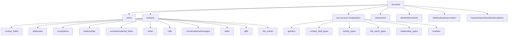
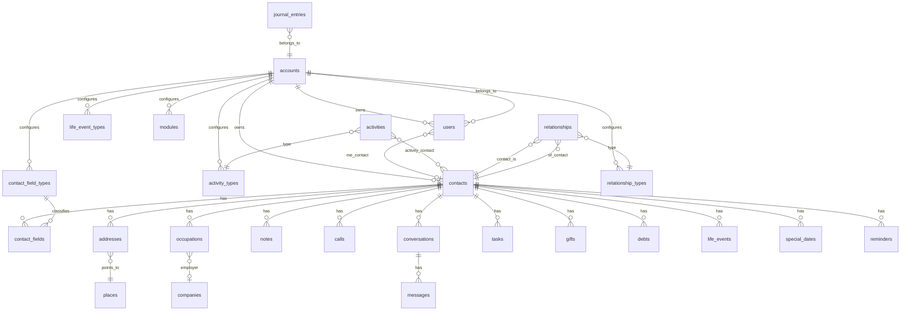

# Architecture

## Runtime Shape

Monica 4.x is a Laravel 9 application on PHP 8.1 with Vue 2/Tachyons/Bootstrap frontend assets. The dependency surface is declared in [composer.json](../monica-4.x/composer.json#L13) and [package.json](../monica-4.x/package.json#L2). Routes are split by concern: `/api` routes load under the API namespace, `/oauth` loads under the API OAuth namespace, and web routes load from `routes/web.php` plus `routes/special.php` ([RouteServiceProvider](../monica-4.x/app/Providers/RouteServiceProvider.php#L78)).

The core application directories are conventional Laravel:

- `app/Models` - Eloquent models grouped by domain: `Account`, `Contact`, `Journal`, `Relationship`, `Instance`, `Settings`, `User`.
- `app/Services` - command-style business operations. Controllers usually validate/request data and delegate creation/update/destruction here.
- `app/Http/Controllers` - web controllers, API controllers, and DAV backends.
- `app/Http/Resources` - API JSON serializers.
- `app/ExportResources` - JSON export serializers.
- `database/migrations` - long-running schema history. The final inferred schema is in the generated schema docs.
- `routes` - web/API/OAuth/special route registration.

## Tenant Boundary

The root business aggregate is `accounts`. Almost every user-owned table has `account_id`, and `Account` exposes relationship methods for contacts, activities, tasks, reminders, notes, files, imports, exports, DAV records, relationship definitions, modules, and audit logs ([Account model](../monica-4.x/app/Models/Account/Account.php#L92)). `users` belong to an account and can optionally point to a contact row representing the user with `me_contact_id` ([User model](../monica-4.x/app/Models/User/User.php#L104)).

## Main Domain Areas

Contacts are the center. The `contacts` table stores names, avatar state, archive/delete flags, first-met narrative, birthday/deceased/first-met special-date pointers, CardDAV fields, and denormalized UI counters. Most feature data hangs from contacts: contact fields, addresses, activities, calls, notes, conversations/messages, tasks, gifts, debts, reminders, life events, occupations, photos, documents, tags, and relationships ([Contact model](../monica-4.x/app/Models/Contact/Contact.php#L178)).

Customization data is account-scoped. Default tables such as `default_contact_field_types`, `default_activity_types`, `default_life_event_types`, `default_relationship_types`, and `default_contact_modules` seed per-account copies that users can customize. Those per-account copies are the rows live contacts reference.

Journal data is polymorphic. `activities`, `entries`, and `days` use `Journalable`, which creates `journal_entries` records through `journalable_id` and `journalable_type` ([Journalable trait](../monica-4.x/app/Traits/Journalable.php#L16)).

DAV data is bolted onto the same contact/task model. The LaravelSabre service registers CardDAV and CalDAV roots, plugins, sync, ACL, and auth ([DAVServiceProvider](../monica-4.x/app/Providers/DAVServiceProvider.php#L36)). Local address books live in `addressbooks`; remote subscriptions live in `addressbook_subscriptions`; contact rows carry `address_book_id`, cached `vcard`, and remote `distant_etag`.

## High-Level ER Diagram

## Lifecycle And Data Flow

1. Account creation creates an `accounts` row, a `users` row, and per-account seed data for contact field types, genders, life event types, modules, activity types, reminder rules, and relationship types through population services under `app/Services/Auth/Population`.
2. Contact creation writes `contacts`, then secondary services add contact fields, addresses, birthday/special dates, reminders, avatar data, tags, and audit logs depending on request data.
3. Interactions write their own tables and often update denormalized contact fields. Activities attach contacts through `activity_contact`; notes, calls, gifts, debts, conversations, messages, tasks, reminders, life events, documents, and photos are direct or pivot relations.
4. Background jobs handle exports, vCard imports, DAV synchronization, geocoding, weather, reminder delivery, stay-in-touch scheduling, avatar updates, and audit logging.
5. Exports create an `export_jobs` row, queue `ExportAccount`, write a temp file locally, move it to the configured storage disk, then allow download through `Settings\ExportController`.

## Important Compatibility Observations

- Integer ids are still the backbone. UUIDs were added later and are lazily generated by `HasUuid` when accessed if missing ([HasUuid](../monica-4.x/app/Traits/HasUuid.php#L13)).
- Archive and delete are not identical. Contacts have `is_active` for archive plus `deleted_at` for soft delete.
- Monica's own SQL export is account-scoped and hard-coded, not a full schema dump. It omits some newer final columns and platform tables; raw database backups may contain more data than exported SQL.
- Some columns and tables are legacy compatibility artifacts. The importer should tolerate absent columns, extra columns, and old enum/string values.
